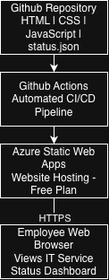
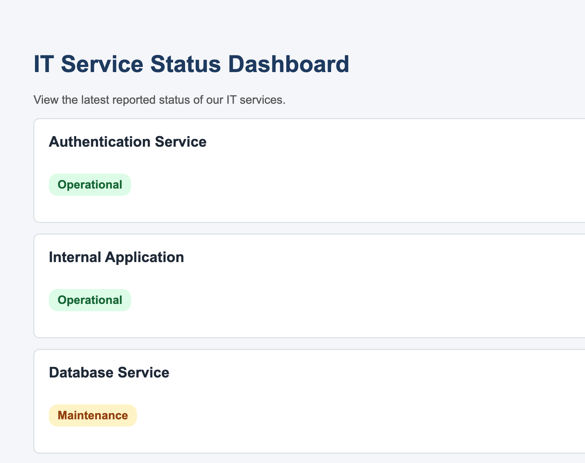

# Azure Cloud Deployment & CI/CD Lab

**Live Application:** [View IT Service Status Dashboard](https://white-moss-0f7affa10.4.azurestaticapps.net/)

## 1. Project Overview

This project demonstrates the development and deployment of a self-directed cloud lab hosted on Microsoft Azure designed to strengthen my understanding of cloud architecture, Infrastructure as Code (IaC), CI/CD pipelines, deployment automation, and application reliability.

To apply these concepts, I developed and deployed a simple Service Status Dashboard using Microsoft Azure.

The primary focus of this project was not to build a complex application, but to gain practical experience in understanding how cloud infrastructure, version control, automated testing, and deployment processes work together. I also explored troubleshooting, failure testing, infrastructure provisioning, and recovery procedures.

## 2. Technologies Used

- **Azure Static Web Apps**: Cloud Application hosting
- **Azure Bicep**: Infrastructure as Code
- **Azure CLI**: Managing and validating Azure resources
- **GitHub Actions**: CI/CD automation
- **Git & GitHub**: Version control and source code management
- **Python**: Data validation and regression testing
- **HTML**: Application structure
- **CSS**: Application styling
- **JavaScript**: Dynamic service status display
- **JSON**: Service information storage

## 3. Architecture

The application follows a cloud-based architecture using GitHub, GitHub Actions, and Azure Static Web Apps.

Application development begins locally, where source code and configuration files are created and modified.

Changes are commited and pushed to GitHub, where GitHub Actions runs automated validation and regression tests before deploying the application to Azure Static Web Apps.

Azure hosts the dashboard and makes it accessible through a web browser.

The architecture demonstrates how source control, automated testing, and cloud hosting work together to support application delivery.

## 4. Application Features

The IT Service Status Dashboard should displaysthree internal service examples:

- Authentication Service: Operational
- Internal Application: Operational
- Database Service: Maintenance

Each service is displayed with a status indicator to help users identify its reported condition.

JavaScript dynamically retrieves service information from a JSON file and displays it on the dashboard.

The application also includes basic error handling for missing or invalid service information.

Service statuses are manually maintained. The dashboard does not independently monitor service availability.

## 5. CI/CD Pipeline

GitHub Actions automates the application's validation, testing, and deployment process.

When changes are pushed to the main branch, the pipeline performs the following operations:

1. Retrieves the latest application source code.
2. Runs a Python script to validate service information.
3. Executes three automated regression tests.
4. Deploys the application to Azure Static Web Apps when the required checks succeed.

This workflow helps identify invalid service data before deployment and reduces the need for manual application updates.

Evidence: [Successful CI/CD Workflow](docs/evidence/ci-success.png)

## 6. Infrastructure as Code - Azure Bicep

I also incorporated Azure Bicep to develop a foundational understanding of Infrastructure as Code.

Rather than configuring every resource manually through the Azure Portal, Bicep allows Azure infrastructure to be defined through reusable configuration files.

During this exercise, I:

- Created Bicep templates describing Azure Static Web Apps resources.
- Compiled and validated the infrastructure configurations.
- Used Azure What-If to preview proposed changes.
- Provisioned a separate, temporary Azure Static Web App using Bicep.
- Verified the created resource using Azure CLI and the Azure Portal.
- Practiced infrastructure cleanup after testing.

The existing dashboard was not redeployed or reconfigured through Bicep. The provisioning exercise used a separate sandbox resource to avoid interfering with the working application.

This exercise introduced infrastructure consistency, repeatability, configuration validation, and resource lifecycle management.

Documentation: [Bicep Infrastructure Exercise](infra/README.md)

Evidence: [Bicep Resource Provisioning](docs/evidence/bicep-resource-created.png)

## 7. Testing and Recovery

Testing and recovery procedures were implemented to explore how the application responds to invalid data and unwanted changes.

Data validation: A Python script checks service information before deployment.

Regression Testing: Three automated tests verify expected validation behavior.

Failure Testing: Invalid service data was intentionally introduced to confirm that the deployment workflow would reject the change.

Rollback Testing: An application change was deployed and later reversed using git revert, restoring the previous service configuration.

These exercises provided experience with automated quality checks, troubleshooting, version control, and recovery procedures.

Supporting Evidence:

- [Failed Validation Test](docs/evidence/ci-validation-failure.png)
- [Original Application Update](docs/evidence/git-operational-update.png)
- [Git Rollback](docs/evidence/git-rollback.png)

## 8. Engineering Decisions

Several technical decisions were made to keep the environment manageable while supporting the learning objectives.

Cloud Hosting: Azure Static Web Apps was selected because the application uses HTML, CSS, JavaScript and JSON. This helps avoid unnecessary VM (Virtual Machine) and operating system maintenance.

Data storage: JSON was selected because the application only requires a small amount of structured service information. The tradeoff is that statuses must be manually updated.

Deployment Automation: GitHub Actions was used to create a repeatable process for application validation, testing, and deployment.

Infrastructure as a Code: Bicep was introduced to explore defining and provisioning Azure resources through code rather than relying exclusively on manual configuration.

Version Control: Git was used to track changes and practice restoring previous application configurations.

## 9. Future Improvements & Lessons Learned

This project has helped me develop a stronger foundational understanding of cloud engineering through practical implementation.

### Key lessons:
- Understanding how Azure infrastructure supports a hosted application.
- Automating application deployments through GitHub Actions.
- Using Python to validate application data and test expected behavior.
- Defining and provisioning infrastructure through Azure Bicep.
- Troubleshooting deployment workflows and Git authentication issues.
- Practicing failure detection, recovery, and infrastructure cleanup.

### Future Improvements:

The current dashboard is just a learning application and doesn't provide production-grade monitoring.

Improvements include:
- Automated service health checks.
- Azure monitoring and alerting.
- Authentication and administrative access controls.
- A backend service for collecting real-time status information.
- More comprehensive infrastructure as Code and CI/CD integration.

The improvements will help extend this project into a more advanced cloud engineering environment.